  <picture>
    <source media="(prefers-color-scheme: dark)" srcset="assets/hero-dark.svg">
    
  </picture>

 

<picture>
  <source media="(prefers-color-scheme: dark)" srcset="assets/titre-apropos-dark.svg">
  
</picture>

Je conçois des interfaces nettes et rapides, de la maquette sur **Figma** jusqu'à la mise en ligne. Côté web je travaille avec **Next.js**, **React** et **TypeScript** ; pour les logiciels de bureau avec **Electron**, et pour Android TV avec **Kotlin**.

Je suis aussi le fondateur de **[DigiRepair](https://digirepair.fr)**, un atelier de réparation de smartphones, PC, consoles et tablettes à Valenciennes. J'en fabrique moi-même le site, les logiciels internes et les vidéos.

 

<picture>
  <source media="(prefers-color-scheme: dark)" srcset="assets/titre-realisations-dark.svg">
  
</picture>

  <a href="https://digirepair.fr"><picture>
    <source media="(prefers-color-scheme: dark)" srcset="assets/projet-digirepair-dark.svg">
    
  </picture></a>
  <picture>
    <source media="(prefers-color-scheme: dark)" srcset="assets/projet-atelier-dark.svg">
    
  </picture>

  <picture>
    <source media="(prefers-color-scheme: dark)" srcset="assets/projet-onde-dark.svg">
    
  </picture>
  <picture>
    <source media="(prefers-color-scheme: dark)" srcset="assets/projet-controller-lab-dark.svg">
    
  </picture>

 

<picture>
  <source media="(prefers-color-scheme: dark)" srcset="assets/titre-outils-dark.svg">
  
</picture>

<picture>
  <source media="(prefers-color-scheme: dark)" srcset="assets/outils-dark.svg">
  
</picture>

  

<picture>
  <source media="(prefers-color-scheme: dark)" srcset="assets/titre-contact-dark.svg">
  
</picture>

 

  <a href="https://www.linkedin.com/in/jonathan-favorel/"><picture>
    <source media="(prefers-color-scheme: dark)" srcset="assets/linkedin-dark.svg">
    
  </picture></a>

<picture>
  <source media="(prefers-color-scheme: dark)" srcset="assets/vague-dark.svg">
  
</picture>
